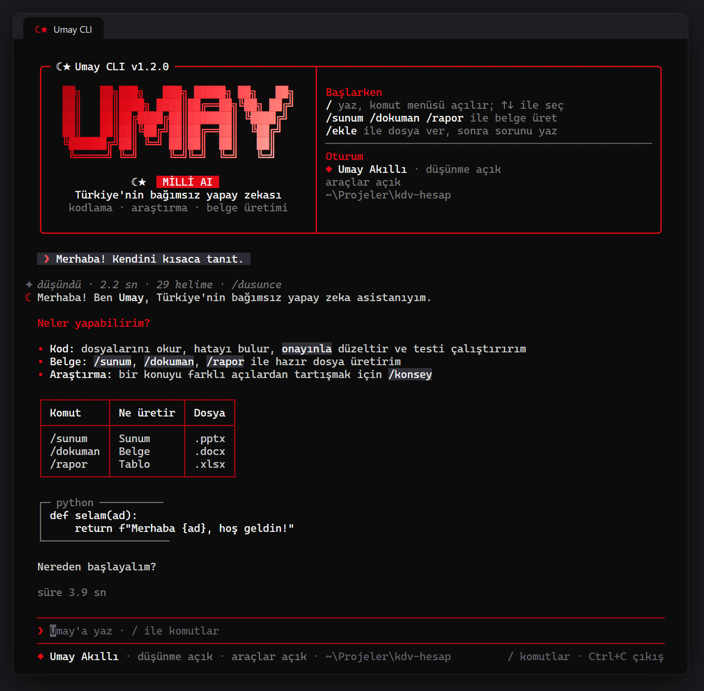
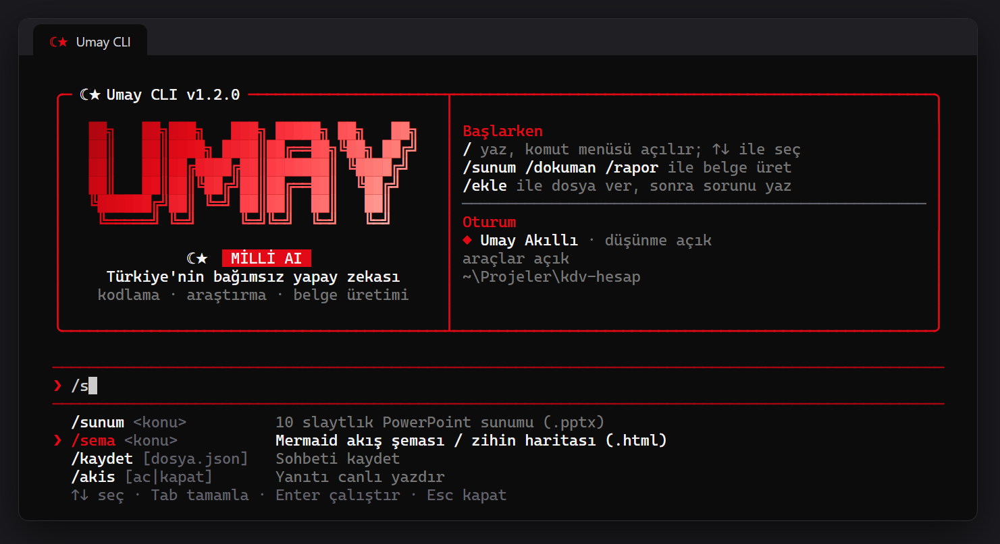
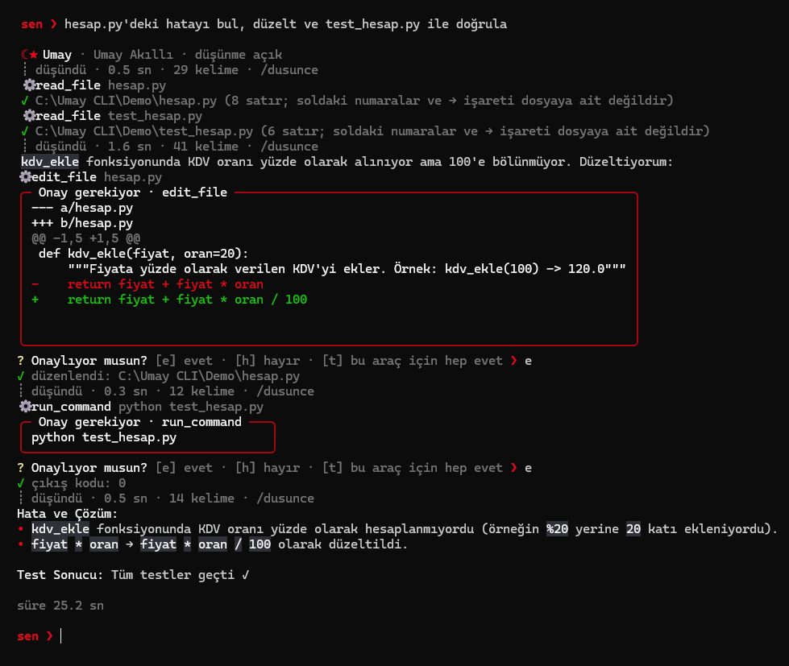

# ☾★ Umay CLI

Umay yapay zekası için Türkçe terminal uygulaması. [umayzeka.com](https://umayzeka.com)'un OpenAI uyumlu API'siyle sohbet eder; bilgisayarındaki dosyalarla çalışır; PowerPoint, Word, Excel, şema ve web projesi üretir.

> Umay'ın resmî komut satırı uygulamasıdır. [Eray Çiçek](https://github.com/cekYc) tarafından geliştirilir ve [Umay Official](https://github.com/Umay-Official) hesabında yayımlanır.

<p align="center"></p>

## Özellikler

- **Sohbet:** Umay'ın sunduğu tüm modeller (Umay Akıllı, Hızlı, Ultra Hızlı, Daha Zeki ve Mistral Large 4, DeepSeek, MiniMax, GLM gibi açık modeller), canlı yazım akışı, düşünme modu. Model listesi Umay'dan alınır; yeni model eklenince CLI'yi güncellemek gerekmez. `/durum` hangi modelin şu an düzgün yanıt verdiğini gösterir. Yanıtlar terminalde biçimli görünür: başlıklar, maddeler, kutulu tablolar, kod blokları. Her yanıtın altında süre ve, sunucu bildirirse, üretilen token ve token/sn yazar.
- **Komut menüsü:** `/` yazınca eşleşen komutlar girdi alanının altında listelenir; ↑↓ seçer, Tab tamamlar, Enter çalıştırır. Komut argümanları (model adları, dosya yolları) da aynı listede çıkar. `/` + Enter tüm komutları gösterir.
- **Yerel araçlar:** Umay klasördeki dosyaları listeler, okur, arar, düzenler; PowerShell ve Python çalıştırır. Yazma ve komutlar her seferinde onay ister. Araçlar [Gambit AI CLI](https://github.com/cekYc/gambit-ai-cli) projemden gelir.
- **Belge üretimi:** `/sunum` (.pptx), `/dokuman` (.docx), `/rapor` (.xlsx), `/sema` (Mermaid .html), `/proje` (HTML/CSS/JS + .zip).
- **Uzmanlar konseyi:** `/konsey` ile yazılımcı, tasarımcı ve pazarlamacı bir konuyu tartışır, moderatör özetler.
- **Bellek:** `/bellek ekle` ile kaydedilen notlar her sohbette Umay'a hatırlatılır; notlar bilgisayarında düz metin dosyada durur.
- **Ekler ve GitHub:** `/ekle` ile metin, kod, Word, Excel, PowerPoint dosyası; `/github` ile herkese açık bir depoyu indirip incelettirme.
- **Kıyaslama:** Gambit Bench v2'nin 39 görevinde düşünme açıkken Umay Akıllı 89,4, Umay Hızlı 87,2, Umay Daha Zeki 71,3, Umay Ultra Hızlı 61,7 puan aldı. Grafikler, koşullar ve sınırlar: [docs/KIYASLAMA.md](docs/KIYASLAMA.md).
- **Kırmızı-beyaz arayüz:** ☾★ logolu karşılama paneli, çerçeveli girdi alanı ve altında durum satırı (model, düşünme, araçlar, klasör), satır numaralı ve renkli değişiklik farkları, canlı düşünme göstergesi.

## Gereksinimler

| | Sürüm | Ne için |
| --- | --- | --- |
| [Node.js](https://nodejs.org) | 22 veya üstü | Uygulamanın kendisi |
| [Python](https://www.python.org) | 3.10 veya üstü | Yerel araçlar (`--no-tools` ile gerekmez) |
| [Git](https://git-scm.com) | herhangi | Yalnızca `/github` komutu |
| Umay API anahtarı | `umay-sk-...` | [umayzeka.com](https://umayzeka.com) → Geliştirici & API Paneli → Yeni Anahtar Oluştur |

Windows 11'de geliştirildi ve test edildi. macOS ve Linux'ta araçlar `sh` kullanır, ancak bu sistemlerde denenmedi.

## Kurulum

```powershell
git clone https://github.com/Umay-Official/Umay-CLI.git
cd Umay-CLI
npm ci
npm link
```

Artık herhangi bir klasörde `umay` yazarak başlatabilirsin. Araçlar ve üretilen dosyalar o klasörde çalışır.

**Windows PowerShell'de "running scripts is disabled" hatası:** `npm link`, PowerShell için bir `umay.ps1` betiği oluşturur ve Windows PowerShell 5 betikleri varsayılan olarak çalıştırmaz. Üç çözümden birini seç:

- `umay` yerine `umay.cmd` yaz.
- `%APPDATA%\npm\umay.ps1` dosyasını sil; PowerShell o zaman `umay.cmd`'yi kullanır.
- Betiklere kendi hesabın için izin ver: `Set-ExecutionPolicy -Scope CurrentUser RemoteSigned`.

Kurulum yapmadan denemek için depo klasöründeki `umay.cmd` dosyasına çift tıklayabilirsin; eksik paketleri kendisi kurar.

## Başlarken

İlk açılışta Umay API anahtarın sorulur. Anahtarı yapıştırıp Enter'a bas; ekranda görünmez. CLI anahtarı Umay'a sorup doğrular ve bu bilgisayarda saklar, sonraki açılışlarda bir daha sormaz:

- **Windows:** Windows'un DPAPI şifrelemesiyle (Kimlik Bilgisi Yöneticisi'nin kullandığı yöntem) şifrelenip `~/.umay/anahtar.dpapi` dosyasına yazılır. Dosya yalnızca senin Windows hesabınla çözülebilir.
- **macOS:** Anahtar Zinciri'ne (Keychain) kaydedilir.
- **Linux ve diğerleri:** `~/.umay/anahtar` dosyasına, yalnızca senin okuyabileceğin izinlerle, şifresiz yazılır.

`/anahtar` anahtarı değiştirir, `/anahtar durum` nereden geldiğini gösterir, `/anahtar sil` kayıtlı anahtarı siler. `UMAY_API_KEY` ortam değişkeni (veya `.env` dosyası) ayarlıysa kayıtlı anahtar yerine o kullanılır.

İlk denemeler:

```text
Bu klasördeki dosyaları listele
/sunum Yapay zekanın eğitimdeki yeri
/dusunme ac
/yardim
```

## Komutlar

<p align="center"></p>

`/` yazınca eşleşen komutlar girdi alanının altında listelenir: ↑↓ seçer, Tab tamamlar, Enter çalıştırır, Esc kapatır.

| Grup | Komut | İşlev |
| --- | --- | --- |
| Sohbet | `/yeni` | Yeni sohbet |
| | `/gecmis` | Oturumdaki mesajlar |
| | `/kaydet [dosya.json]`, `/yukle <dosya.json>` | Sohbeti kaydet / aç (var olan dosyanın üzerine yazmaz) |
| | `/bellek`, `/bellek ekle <not>`, `/bellek sil <no>` | Kalıcı notlar: her sohbette Umay'a hatırlatılır (`temizle`, `ac`, `kapat`) |
| | `/cok-satir` | Çok satırlı mesaj; `/gonder` gönderir, `/iptal` vazgeçer |
| | `/cikis` | Çık (Ctrl+D veya boş satırda Ctrl+C da çıkar; satırda yazı varken Ctrl+C satırı temizler) |
| Model | `/model [ad]` | Modelleri listele veya değiştir: `akilli`, `hizli`, `ultra`, `zeki`, `mistral`, `deepseek`, `minimax`, `glm`… Liste Umay'ın `/v1/models` yanıtından gelir; `/akilli` ve `/hizli` kısayoldur |
| | `/durum` | Her modele düşünme kapalı tek kelimelik bir soru sorar; hangisi çalışıyor, hangisi yavaş, hangisi bozuk yanıt veriyor gösterir |
| | `/dusunme [ac\|kapat\|otomatik]` | Düşünme: açık en iyi sonucu verir, kapalı hızlıdır, otomatikte Umay karar verir (varsayılan) |
| | `/dusunce` | Son yanıtın düşüncesini tam göster |
| | `/akis [ac\|kapat]` | Canlı yazım akışı |
| | `/anahtar [sil\|durum]` | API anahtarını değiştir, kayıtlıysa sil veya nereden geldiğini gör |
| Dosya ve kod | `/ekle <dosya>`, `/ekler [temizle]` | Sonraki mesaja dosya ekle; bekleyen ekleri gör |
| | `/github <depo>` | Herkese açık depoyu indir, klasörüne geç, yapısını Umay'a ver |
| | `/cd [klasör]` | Çalışma klasörü |
| | `/araclar [ac\|kapat]` | Yerel araçları aç/kapat |
| | `/oto [ac\|kapat]` | Yazma ve komutları onay sormadan çalıştır |
| | `/geri-al` | Son dosya değişikliğini geri al |
| Üretim | `/sunum <konu>` | 10 slaytlık PowerPoint: kırmızı kapak, ay-yıldız, konuşmacı notları |
| | `/dokuman <konu>` | Word: rapor veya dilekçe; başlıklar, tablolar, sayfa numarası |
| | `/rapor <konu>` | Excel: başlıklı tablo, filtre, sabit başlık, toplam satırı, özet sayfası |
| | `/sema <konu>` | Mermaid akış şeması: tarayıcıda açılan .html (SVG indirilebilir) + .mmd |
| | `/proje <tanım>` | HTML/CSS/JS web projesi: klasör + .zip |
| | `/konsey <konu>` | Uzmanlar konseyi (4 istek) |
| | `/ac` | Son üretilen dosyayı aç |

Türkçe karakterli yazımlar (`/düşünme`, `/şema`) ve İngilizce adlar (`/help`, `/tools`, `/undo`, `/exit` …) da çalışır. Model, düşünme ve akış tercihleri `~/.umay/ayarlar.json` dosyasında saklanır.

### Üretim komutları nasıl çalışır

Umay sitesinde bu komutlar Umay'ın sunucusunda çalışır; API anahtarı ise yalnızca sohbet uç noktasına erişir. Umay CLI aynı işi yerelde yapar: modelden yapılandırılmış bir yanıt ister (JSON, Markdown, Mermaid veya `DOSYA:` blokları), dosyayı bilgisayarında oluşturur.

- Yanıt beklenen biçimde değilse model bir kez düzeltmeye çağrılır; yanıt uzunluk sınırında kesildiyse daha kısa yazması istenir. Yine olmazsa ham yanıt `~/.umay/son-uretim-hatasi.txt` dosyasına kaydedilir.
- Bugünün tarihi isteğe eklenir, böylece belgelerdeki tarihler doğru olur.
- Dosyalar çalışma klasörüne yazılır; var olan dosyaların üzerine yazılmaz (`-2`, `-3` eklenir).
- `/proje` düşünme modunu kullanmaz ve en fazla 3 dosya ister. Proje dosyaları klasör dışına yazılamaz.
- `/ekle` ile eklenen dosyalar üretim komutlarına da gider: `/ekle satislar.csv`, ardından `/rapor aylık özet`.

### Ekler ve GitHub

`/ekle` metin ve kod dosyalarını, `.docx`, `.xlsx` ve `.pptx` belgelerinin metnini kabul eder (60.000 karaktere kadar). Metin dosyaları UTF-8 değilse Windows-1254 (Excel'in CSV dışa aktarımı) veya UTF-16 (Windows PowerShell çıktısı) olarak okunur. PDF okunamaz. Görseller varsayılan olarak kapalıdır. 11 Kasım 2026'dan beri Umay API görselleri işliyor (istek Umay Hızlı'ya gidiyor, [API gözlemleri](docs/API-GOZLEMLERI.md)); `UMAY_IMAGES=1` ile açılabilir.

`/github kullanici/depo` veya tam adres, depoyu `git clone --depth 1` ile çalışma klasörüne indirir, o klasöre geçer ve dosya ağacıyla README'yi sonraki mesaja ekler. Yalnızca herkese açık GitHub depoları içe aktarılır.

### Sitede olup CLI'de olmayanlar

`/derin-arastirma` (canlı web araması), `/yt-özetle` ve `/mail` Umay sitesinin kendi sunucusunda ve site oturumuyla çalışır; API anahtarıyla erişilemez. Bu komutlar yazılınca CLI nedenini açıklar. Sitedeki bellek de site hesabına bağlıdır ve API'den kullanılamaz; CLI'nin kendi belleği için [Bellek](#bellek) bölümüne bak.

## Bellek

`/bellek ekle <not>` ile Umay'ın her sohbette bilmesini istediğin şeyleri kaydedersin: adın, kullandığın diller, yazım tercihlerin gibi. Notlar her istekte (sohbet, belge komutları, konsey) sistem mesajı olarak Umay'a gönderilir; sohbet geçmişine eklenmez, `/yeni` sonrası da geçerlidir.

```text
/bellek ekle Adım Eray, dilekçelerde bu adı kullan
/bellek ekle Kod örneklerinde Python 3.12 ve tip ipuçları kullan
/bellek            notları listeler
/bellek sil 2      2 numaralı notu siler
/bellek kapat      notları saklar ama göndermez
```

Notlar `~/.umay/bellek.md` dosyasında düz metin olarak durur; her `- ` ile başlayan satır bir nottur ve dosyayı elle de düzenleyebilirsin. Her istekte en fazla 4.000 karakterlik not gönderilir (fazlası varsa en yeniler). Notlar Umay API'ye gönderildiği için şifre veya kimlik numarası gibi gizli bilgileri belleğe yazma.

## Yerel araçlar ve güvenlik

Araçlar, yerel modellerle çalışan [Gambit AI CLI](https://github.com/cekYc/gambit-ai-cli) projemden (`ai-cli/tools.py`) alındı ve Umay CLI'ye uyarlandı: Node.js tarafına bir Python köprüsü (`python/bridge.py`), çalışan komutları iptal etme ve metin tabanlı araç çağrısı eklendi.

Örnek: "hesap.py'deki hatayı bul, düzelt ve test_hesap.py ile doğrula" isteğinde Umay dosyaları okuyor, düzeltmeyi farkıyla onaya sunuyor, testi onayla çalıştırıp sonucu söylüyor.

<p align="center"></p>

| Araç | Ne yapar | Onay |
| --- | --- | --- |
| `list_dir` | Dosya ve klasörleri listeler | — |
| `read_file` | Dosyayı satır aralığıyla okur | — |
| `search_files` | Dosya içeriklerinde arar | — |
| `write_file` | Dosya oluşturur veya üzerine yazar; önce farkı gösterir | Evet |
| `edit_file` | Dosyada bir metni değiştirir; önce farkı gösterir | Evet |
| `run_command` | PowerShell (Windows) veya sh komutu çalıştırır | Evet |
| `run_python` | Python kodu çalıştırır | Evet |

- Onay kutusunda `e` o işlemi, `t` o araç için oturumun geri kalanını onaylar; `h` reddeder.
- Onay sorusunu yalnızca soru göründükten sonra yazılan satır yanıtlar; önceden yazılmış satırlar onay sayılmaz.
- Bir tur yarıda kesilirse (Ctrl+C, bağlantı veya sunucu hatası) tamamlanan adımlar ve sonuçları sohbette kalır; "devam et" yazınca Umay kaldığı yerden sürdürür.
- Önizlemeden sonra değişmiş bir dosyaya yazılmaz; dışarıdan değişmiş bir dosya geri alınmaz.
- `UMAY_PROTECTED_DIRS` ile verilen klasörlere yazma araçları dokunamaz.
- Komut ve Python araçları işletim sistemi düzeyinde yalıtılmış (sandbox) değildir. Neyin çalışacağı önizlemede gösterilir; onaylamadan önce oku.
- Okunan dosyalar ve araç çıktıları, modelin yanıt verebilmesi için Umay API'ye gönderilir.
- Umay API yerleşik araç çağrısını (`tools` / `tool_calls`) desteklemediği için araçlar metin protokolüyle çalışır: model `<tool_call>` blokları yazar, CLI yalnızca bu blokları çalıştırır. Ayrıntı: [API gözlemleri](docs/API-GOZLEMLERI.md).

## Tek soru modu

```powershell
umay --prompt "Türkiye hakkında üç kısa bilgi ver"
umay --hizli --dusunme --prompt "17 x 23 kaç?"
umay --prompt "/rapor kitap listesi" --cwd C:\raporlar
"Bu metni özetle" | umay
```

Yanıt standart çıktıya, araç ilerlemesi hata çıktısına yazılır; hata olursa çıkış kodu 1'dir. Bu modda yazma ve komutlar reddedilir, `--yes` ile açıkça izin verilir.

Seçenekler: `--model <ad>`, `--hizli`, `--dusunme`, `--dusunme-kapali`, `--no-stream`, `--no-tools`, `--tool-mode text|native`, `--cwd <klasör>`, `--system <metin>`, `--timeout <sn>`, `--max-steps <n>`, `--yes`, `--base-url <url>`.

`--timeout`, sunucudan hiç veri gelmeden beklenecek en uzun süredir (varsayılan 120 sn). Yanıt akarken, araçlar çalışırken ve onay beklenirken süre işlemez; uzun bir yanıt veya çok adımlı bir görev bu yüzden kesilmez. Akış kapalıyken (`--no-stream`) her isteğin tamamı bu sürede bitmelidir.

## Ortam değişkenleri

| Değişken | Açıklama |
| --- | --- |
| `UMAY_API_KEY` | API anahtarı; ayarlıysa bu bilgisayarda kayıtlı anahtarın yerine kullanılır |
| `UMAY_MODEL` | Model adı veya kısaltması: `umay-akilli` (varsayılan), `hizli`, `ultra`, `mistral`… Umay'ın listesinde olmayan ad için uyarı gösterilir (Umay bilinmeyen adları sessizce Umay Akıllı'ya yönlendirir) |
| `UMAY_THINKING` | `ac`, `kapat` veya `otomatik` (varsayılan otomatik) |
| `UMAY_BASE_URL` | API adresi (varsayılan `https://umayzeka.com/v1`; HTTPS zorunlu, yalnızca localhost için HTTP) |
| `UMAY_PYTHON` | Kullanılacak Python (varsayılan: Windows'ta `python`, diğer sistemlerde `python3`); PATH'te değilse tam yolu, örneğin `C:\Python314\python.exe` |
| `UMAY_TOOL_MODE` | `text` (varsayılan) veya yerleşik araç çağrısı destekleyen sunucular için `native` |
| `UMAY_ARAYUZ` | `sade` yazılırsa çerçeveli girdi alanı ve canlı komut menüsü yerine düz `sen ❯` satırı kullanılır (terminal yeni görünümü düzgün çizmiyorsa) |
| `NO_COLOR` | Ayarlıysa renkler ve çerçeveli arayüz kapanır |
| `UMAY_PROTECTED_DIRS` | Yazma araçlarına kapalı klasörler; Windows'ta `;`, diğer sistemlerde `:` ile ayrılır |
| `UMAY_IMAGES` | `1` ise görsel eklemeye izin verir (API 11 Kasım 2026'dan beri görselleri işliyor) |
| `UMAY_SETTINGS` | Tercih dosyasının yolu (varsayılan `~/.umay/ayarlar.json`); kayıtlı anahtar ve Umay'ın model listesi (`modeller.json`) da aynı klasörde durur |

## Proje yapısı

```text
src/
  cli.mjs          Komut satırı, komutlar, arayüz akışı
  client.mjs       Umay API isteği, akış, düşünme, hata mesajları
  texttools.mjs    Metin tabanlı araç çağrısı protokolü
  tools.mjs        Python araç köprüsüyle iletişim, onaylar
  documents.mjs    /sunum /dokuman /rapor /sema /proje üreticileri
  attachments.mjs  /ekle ve /github
  memory.mjs       /bellek: kalıcı notlar
  keystore.mjs     API anahtarını bu bilgisayarda saklama (DPAPI, Anahtar Zinciri)
  markdown.mjs     Terminalde akan Markdown görünümü
  theme.mjs        Renkler, logo, karşılama paneli, kutular, bekleme animasyonu
  prompt.mjs       Çerçeveli girdi alanı, durum satırı ve canlı komut menüsü
python/
  bridge.py        Node.js ile JSON satırları üzerinden konuşan köprü
  tools.py         Araçların uygulaması (Gambit AI CLI'den)
test/              node:test testleri; sahte sunucu kullanır, API harcamaz
docs/              Ekran görüntüleri, kıyaslama ve API gözlemleri
```

## Geliştirme

```powershell
npm test
npm run check
```

Testler yerel sahte sunucu kullanır, gerçek API isteği yapmaz. `UMAY_INTERACTIVE=1`, komut döngüsünü yönlendirilmiş girişle çalıştırır (betikli denemeler için).

## Kaynaklar ve lisans

Yerel araçlar (`python/tools.py`) [Gambit AI CLI](https://github.com/cekYc/gambit-ai-cli) projemden alınmış ve değiştirilmiştir. Bağımlılıklar ve marka notu: [NOTICE.md](NOTICE.md).

Umay CLI, **PolyForm Noncommercial License 1.0.0** ve **Umay için ek izin** ile lisanslanmıştır ([LICENSE](LICENSE)). Kişisel, eğitim, araştırma ve kâr amacı gütmeyen kullanım serbesttir. Ticari kullanım yalnızca Umay'a izinlidir; diğer ticari kullanımlar için yazılı izin gerekir.

Copyright (c) 2026 Eray Çiçek
