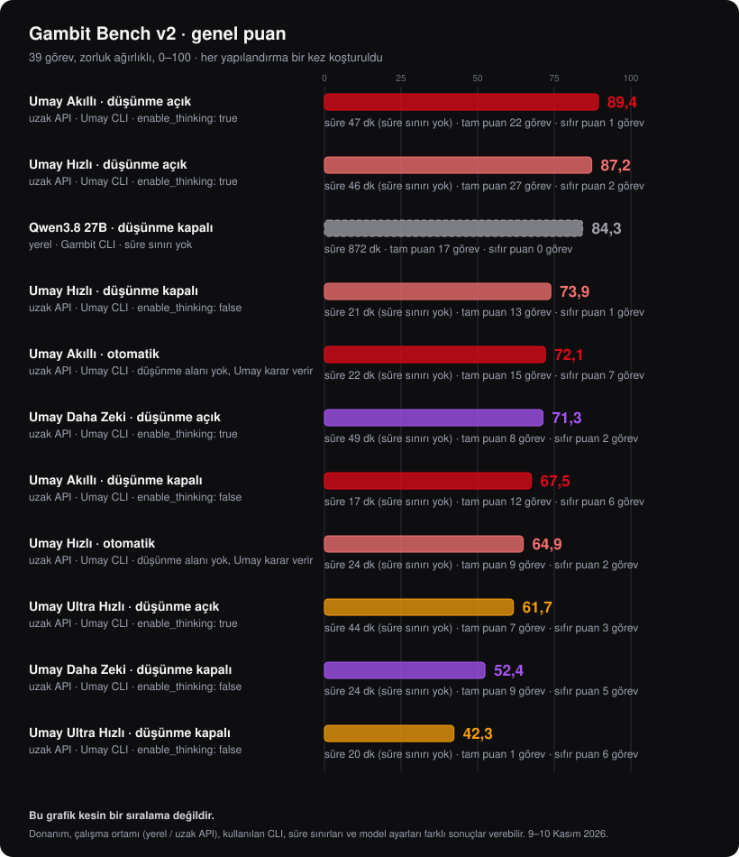
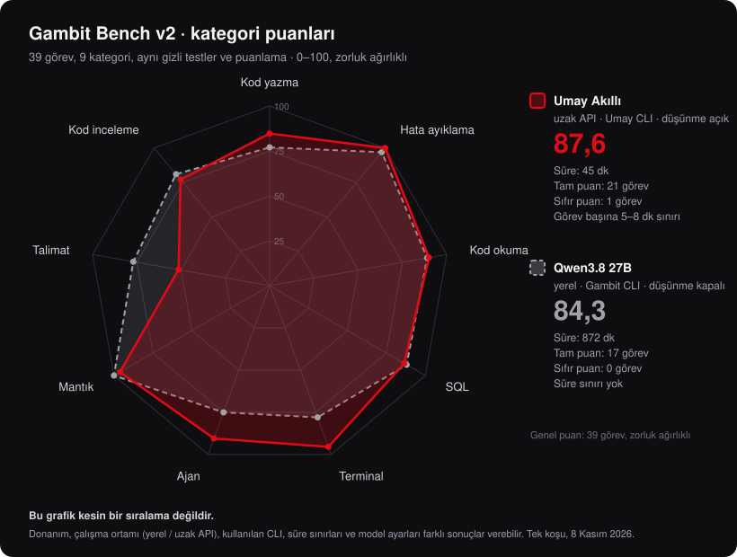

# Kıyaslama: Gambit Bench v2

Umay'ın iki modeli üç düşünme ayarıyla [Umay CLI](../README.md) üzerinden [Gambit AI CLI](https://github.com/cekYc/gambit-ai-cli)'nin 39 görevlik benchmark'ında (Gambit Bench v2) koşturuldu. Görevler; kod yazma, hata ayıklama, kod okuma, SQL, terminal, ajan, mantık, talimat ve kod incelemeyi kapsar. Gizli testler ve rubriklerle kısmi puan verilir, genel puan zorluk ağırlıklıdır (kolay ×1 … çok zor ×4). Karşılaştırma için Gambit ile denenen en iyi yerel model, Qwen3.8 27B de tabloda.

Düşünme ayarları:

- **açık:** İstekte `enable_thinking: true` gönderilir.
- **otomatik:** Düşünme alanı gönderilmez, Umay karar verir. Umay CLI'nin varsayılanı budur.
- **kapalı:** İstekte `enable_thinking: false` gönderilir.

> **Not:** Bu sonuçlar kesin bir sıralama değildir, yalnızca bu koşuların sonucunu gösterir. Donanım, çalışma ortamı (yerel model ya da uzak API), kullanılan CLI ve ajan döngüsü, süre sınırları ve model ayarları sonuçları değiştirebilir. Her yapılandırma bir kez koşturuldu; tekrar koşularda puanlar birkaç puan oynayabilir.

## Genel puan

| Yapılandırma | Genel | Zor görevler | Tam puan | Sıfır puan | Kesilen yanıt | Süre |
| --- | --- | --- | --- | --- | --- | --- |
| Umay Akıllı · düşünme açık | **87,6** | **86,5** | 21 | 1 | 1 | 45 dk |
| Qwen3.8 27B · düşünme kapalı (yerel) | 84,3 | 83,4 | 17 | **0** | – | 872 dk |
| Umay Akıllı · otomatik | 83,2 | 82,1 | 18 | 1 | 1 | 41 dk |
| Umay Hızlı · düşünme açık | 81,4 | 78,6 | 26 | 5 | 5 | 29 dk |
| Umay Hızlı · otomatik | 79,4 | 76,4 | **27** | 6 | 7 | 29 dk |
| Umay Hızlı · düşünme kapalı | 68,7 | 66,7 | 11 | 2 | **0** | **25 dk** |
| Umay Akıllı · düşünme kapalı | 65,2 | 63,5 | 12 | 7 | **0** | 35 dk |

## Kategoriler

| Kategori | Akıllı açık | Akıllı otomatik | Akıllı kapalı | Hızlı açık | Hızlı otomatik | Hızlı kapalı | Qwen3.8 27B |
| --- | --- | --- | --- | --- | --- | --- | --- |
| Kod yazma | **85** | 68 | 55 | 35 | 36 | 75 | 77 |
| Hata ayıklama | **100** | **100** | **100** | 93 | 99 | 65 | 97 |
| Kod okuma | 90 | 87 | 68 | **100** | 93 | 57 | 89 |
| SQL | 87 | 87 | 44 | 84 | **100** | 63 | 88 |
| Terminal | 95 | 93 | 68 | **100** | 73 | 69 | 78 |
| Ajan | **90** | 70 | 28 | 76 | 62 | 62 | 75 |
| Mantık | 96 | 96 | **100** | **100** | **100** | 84 | **100** |
| Talimat | 51 | 78 | 93 | **100** | **100** | 76 | 77 |
| Kod inceleme | 77 | 86 | 80 | 90 | **100** | 90 | 81 |

En iyi Umay sonucu ile en iyi yerel sonuç, kategori kategori:

## Sonuçları okurken

- **Düşünme Umay'a çok yarıyor.** İki modelde de en iyi sonuç düşünme açıkken, en kötüsü kapalıyken geldi; aradaki fark Akıllı'da 22, Hızlı'da 13 puan. Düşünme kapalıyken Akıllı ajan ve SQL görevlerinde çoğu zaman 3–5 adımda durdu ve istenen dosyayı (`cevap.sql`, `ozet.json`) hiç yazmadı.
- **Otomatik modda Umay da düşünüyor.** Alan gönderilmediğinde sonuçlar "açık"a yakın, "kapalı"dan çok daha iyi; yanıtlarda uzun planlar ve kesilmeler de "açık"taki gibi görüldü.
- **Kesilen yanıtlar:** Düşünme açık ya da otomatikken Umay yanıtı belli bir uzunlukta kesiyor: Hızlı'da yaklaşık 26–33 bin karakter (yaklaşık 8 bin token), Akıllı'da 9–13 bin karakter. Model cevaptan önce uzun bir plan yazınca cevap ya da araç çağrısı hiç gelmiyor. Bu koşulardaki 13 sıfırın 13'ü de bundan; Hızlı'nın kod yazmada 35'te kalması da bu yüzden (uzun kod isteyen dört görev).
- **Düşünme kapalıyken kesilme yok.** İki modelin 78 görevinde hiç kesilme olmadı; Hızlı uzun kod görevlerini de bitirdi (kod yazma 35 → 75). Ama genel puan belirgin şekilde düştü.
- **Pratikte:** En iyi sonuç için `/dusunme ac`. Hızlı ile uzun kod ürettirirken `/dusunme kapat` kesilmeleri önler. Umay CLI'nin `/proje` komutu bu yüzden düşünmeyi kapatır.
- **Süre:** Umay yapılandırmaları Gambit'in süre sınırlarıyla (araçlı görevde 8, araçsızda 5 dakika) koştu ve hiçbiri sınıra takılmadı. Qwen3.8 27B süre sınırı olmadan koştu ve görev başına ortalama 22 dakika harcadı.

## Koşullar

| | Umay yapılandırmaları | Qwen3.8 27B |
| --- | --- | --- |
| Model | Uzak, Umay API (`umay-akilli`, `umay-hizli`) | Yerel bilgisayarda |
| Ajan döngüsü | Umay CLI, metin tabanlı araç çağrısı | Gambit CLI, yerleşik araç çağrısı |
| Düşünme | açık / otomatik / kapalı (yukarıda) | Kapalı |
| Süre sınırı | Görev başına 8 dk (araçlı) / 5 dk (araçsız) | Yok |
| Ortak olanlar | Aynı 39 görev, kurulumlar ve notlandırıcılar; onaylar yalnızca görev klasörüne izin veren aynı kuralla; görev başına en fazla 14 model adımı | |

Umay koşuları 8 Kasım 2026'da yapıldı. Qwen3.8 27B değerleri Gambit Bench raporundan alındı.

## Nasıl koşturuldu

Görevler, kurulumları ve notlandırıcılar Gambit AI CLI deposundaki `benchmark/v2` klasöründedir. Umay koşuları için o klasöre şu dosyalar eklendi:

- `umay_kos.py`: Her görevin klasörünü hazırlar, onayları Gambit'in kuralıyla verir, sonucu Gambit'in notlandırıcılarıyla puanlar. `--no-thinking` kapalı, `--server-default-thinking` otomatik modu koşturur.
- `umay_ajan.mjs`: Görevi Umay CLI'nin ajan döngüsüyle görev klasöründe çalıştırır.
- `umay_uc_kosu.ps1`, `umay_kapali_tekrar.ps1`: Yapılandırmaları sırayla koşturan betikler.

Örnekleme ve yanıt uzunluğu Umay sunucusunun varsayılanlarıdır. Token sayıları, Umay akışta kullanım bilgisi göndermediği için kaydedilmedi.
